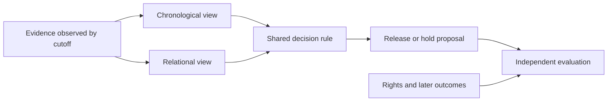

A requester delegates a job. A provider delivers an artifact. The delegate must decide whether to release one simulation credit or hold it. Its record might contain a grant, a revocation, a delivery claim, a verification or an earlier release. Some records may arrive late.

This is the next experiment after the [fixed retrieval diagnostic](results/2026-11-26-retrieval-probe.md). It asks whether two compact views of the **same available evidence** support different decisions. There are no real payments, model calls or changes to anyone's authority.

The difficult case is not just forgetting a record. Suppose a grant was revoked before the decision, but the observer learned about that revocation afterward. A release could be justified by the available evidence and still be unauthorized in the simulated world. An honest evaluation must retain both facts. A later snapshot cannot stand in for what the observer actually knew.

| Record | What it establishes in this experiment |
| --- | --- |
| Rights in force | The simulator's stipulated grants, revocations, disputes and prior releases at the decision time |
| Evidence available | Only records observed by the cutoff; future-effective records cannot change the current decision state |
| Later outcome | Whether the exact artifact was valid and already completed; supplied only to the evaluator |

The chronological view keeps recent whole records. The relational view selects records using their distance from the delegate and artifact, while preserving the direction of the original relationships. Both begin with the same task filter and record encoding. Each has a 2,048-byte limit that includes metadata, source references and any graph index. Both use the same conservative release-or-hold rule. A separate lossless control checks that neither encoding changes facts or decisions when all eligible evidence fits.

A protective effect guard can refuse an unsafe proposal or a duplicate release. That refusal must not erase the bad proposal from the results. Likewise, holding every case may prevent effects while making the system useless. We will report valid timely releases, unsafe and duplicate proposals, missed valid opportunities, holds, missing outputs and total processing costs. Every rate keeps its numerator and denominator; a category with no eligible cases remains unmeasured.

Twelve owned development traces make the contract inspectable. They include late revocation, visible revocation and regrant, missing or contradictory verification, duplicate attempts, reversed authority direction, and two opposite cases of pressure on the storage limit. They are exposed fixtures, not representative samples or evidence of broad capability. Format checks can show that the views fit; they cannot show that either makes better decisions.

After the implementation and evaluator are frozen and independently checked, a separate custodian may generate one 24-case exploratory comparison. The exact final cases do not exist in preparation. Its small scripted result can guide the next research question, not establish superiority or authorize live use. The comparison concerns the complete retention and decision system; differences in selected facts or construction work cannot be attributed to graph encoding alone.

The same separation of identity, dated evidence, authority and outcomes could later support experiments about access to data, compute or delegated services. This pilot tests one contract. It does not measure company dominance, recursive adaptation or generalization across arbitrary entities.
