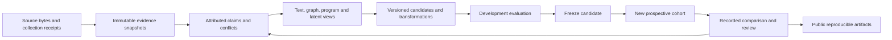

This plan extends the [observatory implementation plan](2026-11-24-recursive-observatory.md). It translates the [research assessment](../research/meta-representational-systems.md) into small components with independently checkable outputs. Phase estimates below are planning estimates, not scheduled delivery promises; one focused implementation cycle includes review and tests.

## Current delivery and boundaries

The existing engine implements local capture, snapshots, representation records, prospective forecasts, resolution, and scoring. This investigation adds a curated source/claim/representation catalog and an offline graph compiler. The compiler validates references and selected field/type rules, embeds explicitly selected **committed** repository documents, and emits a reproducible graph payload. It does not infer truth, browse, extract entities, call models, revise an ontology, or make forecasts.

External source rows contain bibliographic metadata and research notes. They are **not archived article bytes** and must not be admitted as historical evidence snapshots. A compiled graph records its generation time; its Git commit and content hashes identify local inputs, not independently verified times of existence. The full evidence layer remains the existing ledger.

The return arrow proposes a new version. It does not edit earlier evidence, change outcomes, or grant the proposer control over its final evaluator.

## Component contracts

| Component | Minimum contract | Implementation boundary |
| --- | --- | --- |
| Evidence bundle | Observation IDs, bytes/hashes, collection time, source time claims, source spans, coverage and failures | Extend ledger capture; no graph database required. |
| Assertion store | Stable assertion ID; typed subject/predicate/object or value/unit; observer; scope; valid interval; evidence spans; basis; contradiction and correction links | Add validated event types, then disposable SQLite queries. Claims remain separate from edges drawn on screen. |
| Representation registry | Schema/version, encoding kind, snapshot, entities/boundaries/state, units/scale, observer/task/horizon, encoder/query/predictor IDs, parent IDs and construction cost | Multiple candidates can explain the same snapshot. Identity equivalence is a proposed assertion. |
| Transformation registry | Input/output representation IDs; operation; code or prompt hash; parameters; declared loss; evidence mapping; preservation obligations | Splits, merges, aggregation, embedding and revision get explicit semantics. Tests establish only the properties they check. |
| Run manifest | Candidate ID binds encoder, retrieval, memory, predictor, versions, environment, seeds, allowed inputs and resource ceiling | Prevent comparing “same model” with different hidden context or uncharged construction. |
| Evaluator | Frozen task/cohort; scoring; failure treatment; resolution policy; family labels; cost metrics; permitted development feedback | Read-only to candidate runner. Final cohort access logged and irreversible. |
| Revision controller | Allowed changes, proposal budget, development feedback, rejected candidates, stopping rule | Bounded search; no self-issued promotion or evaluator rewrites. |
| Query and presentation adapters | Snapshot, observer, view version, source links, disagreement and missingness | Reuse story graph views after endpoint/identity fixes; export standards at boundaries. |
| Witness adapter | Submitted digest, pending/verified/failed receipt, verification method and retained bundle | Independent existence assurance, not a truth flag. |
| Exchange simulator | Offers, commitments, delivery, independent quality checks, settlement, disputes and rights | Simulated balances first. Real payment and identity protocols remain optional adapters. |

Do not pack all contracts into one unvalidated JSON object. Add one validated event type at a time with fixtures for its invariants. The initial catalog is a research planning format, not a second implementation of the complete production schema.

## Delivery sequence

| Phase and planning effort | Responsible component / caller | Concrete output and acceptance gate |
| --- | --- | --- |
| **0. Research map — this change** | Research investigator; offline catalog compiler | Dated primary-source catalog, attributed claims and challenges, candidate/experiment map; deterministic payload; duplicate/dangling/type checks; committed-source isolation; no paid calls. |
| **1. Claims and time — 2–3 cycles** | Engine maintainer invoked by bounded research automation | Assertion and revision events; source span resolution; world-time vs knowledge-time queries. Late corrections cannot change old snapshots. Opposite/parallel relations and incompatible claims survive replay. |
| **2. Representations and transformations — 2–3 cycles** | Engine maintainer plus independent reviewer | Versioned schemas and candidate identities; split/merge/coarse-grain fixtures; loss reports. A lossy transform cannot claim exact preservation; a rejected transform leaves inputs intact. |
| **3. Retrieval comparison — 2–4 cycles plus bounded model runs** | Retrieval adapter runner; evaluator owns tasks | Frozen local corpus and questions; lexical baseline first, then hybrid and graph challengers. Report citation precision, recall, abstention, cost and stale-result rate by task. Add tools only after a measured baseline. |
| **4. Prospective representation experiment — 2–3 setup cycles, then outcomes** | Candidate runner; independently controlled evaluator | Same future questions, snapshot and predictor; structure and budget controls; fresh final cohort. Record failures and all attempts. No advantage claim from pilot selection. |
| **5. Bounded revision — 2–4 cycles after phase 4 machinery** | Revision controller | Static, fixed-update and reflective-search arms; limited revisions; frozen evaluation; costs and churn. Stop on budget exhaustion, invalid contracts or contaminated evaluation. |
| **6. Control and exchange — separate domain pilots** | Domain adapter and simulator maintainer | Measurable access/control relationships, competing mechanisms and intervention policies; simulated quality/price/latency outcomes. No live settlement required. |

Phases 1 and witness design can proceed independently. Phases 4–5 require enforceable runner/evaluator separation, not just different prompts. Phase 6 can begin with deterministic scripted agents while learned candidate evaluation is still being built. Scaling follows measurement, not a fixed calendar date.

## First three work packets

**Packet A: source-backed assertions.** Add `Assertion` and `AssertionRevision` to the existing engine. Resolve byte spans against captured blobs; retain a span hash and extraction-run identity. Support reported facts, inferred claims, explicit negation and quantities with units. Store disputes and retractions as new events. Tests must cover late-arriving information, copied sources, mistaken identity, and source corrections. Acceptance: replay reconstructs identical historical views and exposes unresolved conflicts.

**Packet B: representation manifests.** Bind each candidate to its evidence snapshot, typed ontology, state/units, task/horizon and executable construction. Introduce transformation runs with parent sets and preservation checks. Register candidate IDs as the engine's method identities so two encodings using one predictor do not collide with `(method, question)` uniqueness. Acceptance: an independent operator can reconstruct a candidate and determine exactly which evidence and costs it used.

**Packet C: a small comparison corpus.** Build a public, reviewed corpus from committed repository documents and permitted external snapshots. Prepare questions for exact facts, relationships, global synthesis, temporal eligibility, contradiction and false premises. A curator writes evidence-based answers; a separate evaluator locks the final portion. Start with offline lexical retrieval and deterministic fixtures. Acceptance: reproducible baseline, explicit unanswered cases, and no future passages entering an earlier snapshot.

## Adoption decisions

Keep SQLite and the current blob store until a measured query or concurrency problem requires something else. Adopt maintained retrieval libraries instead of writing a search engine. Trial Graphiti for temporal retrieval and GraphRAG for global summaries behind adapters with pinned revisions; neither owns the source of truth. Export PROV/RDF and validate SHACL at interchange boundaries after the internal contracts stabilize. Investigate refinement types or functorial migrations only where concrete transformations need stronger guarantees.

Defer a general vector database, autonomous ontology discovery, a universal causal simulator, a token, public payments, and a new multi-agent orchestration framework. Each would add infrastructure before the essential question is tested. Existing tools can supply implementations; the distinctive work is evidence eligibility, competing interpretations, preserved transformations, and credible evaluation.

## Automation and knowledge growth

The existing daily research automation reads `TODO.md` and the observatory plan. This change adds the next packets to that queue; it does not create another scheduler or alter its existing zero-paid-call budget. The current automation remains a bounded investigator, not an unrestricted research service.

For each future authorized run, the scheduler should select one unblocked packet, freeze relevant inputs, run the narrow checks, and produce a reviewed artifact or an explicit failure record. The proposed automation extensions are:

| Trigger | Action | Boundary and output |
| --- | --- | --- |
| New approved source or source revision | Capture exact content, record failure if unavailable, propose claim changes | Source allowlist, size/time limits, no source-instruction execution. Extraction remains a proposal. |
| Curated catalog or relevant code changes | Validate catalog and rebuild a new graph artifact | No overwrite of historical exports; compiler reads committed document bytes. |
| Conflict or ungrounded claim detected | Add a research question with evidence requirements | Never silently choose the newer source or count a self-citation as confirmation. |
| Sufficient new resolved cases | Run the registered comparison | Cohort minimum and stopping rule fixed before outcomes; no repeated significance hunting. |
| Candidate passes development gate | Freeze candidate and queue prospective evaluation | Evaluator and final cohort inaccessible to optimizer. |
| Final evaluation and independent review complete | Draft a reproducible result page and updated research status | Publication follows repository review/deployment policy; no invented success claims. |

These triggers beyond the existing daily loop are **planned**, not installed by this change. Use no paid model calls until a concrete provider/model and per-run ceiling are configured under the user's standing authorization and applicable controls. Stop work at the resource ceiling while preserving partial records; do not treat failure as an empty successful extraction.

Knowledge growth should prioritize uncertainty reduction: an unresolved high-impact claim, a broken evidence link, a failed transform, or a missing control is more valuable than another thousand loosely connected entities. Each proposed research task should state what result would change a decision. Cap source expansion and candidate branching; preserve rejected proposals so the system does not repeatedly rediscover them.

## Scaling gates

Measure a local workload at roughly 100, 1,000 and 10,000 documents before selecting distributed storage. At each scale, hold question families fixed and record input bytes, assertion count, ingest/update time, memory, storage, p50/p95 query latency, retrieval recall, citation precision, temporal violations and rebuild reproducibility. These are planned checkpoints, not capacities already demonstrated.

Partition by access scope and snapshot eligibility before retrieval; post-filtering an answer is insufficient if hidden material influenced candidate selection. Use incremental projections only after a full rebuild is correct. Cache keys include snapshot, schema, extractor and embedding versions. Backups must preserve source bytes as well as database references. Retention and deletion policies need explicit treatment before ingesting personal or restricted material.

## Site and presentation integration

| Surface | Clarification to build after the data contracts |
| --- | --- |
| Landing page | One plain research question, one real example, visible current status, and a clear path to participate. Link this research map from the research program. |
| Five-step overview | Show the same evidence represented as a company, dependency graph and decision-rights graph; name the question each helps answer. |
| Animated lattice | Use controlled morphs to demonstrate split, merge and change of scale. Label transformation and information loss; pause/reduced-motion behavior; no meaningless confidence animation. |
| Observatory | Select snapshot and candidate; inspect evidence, disagreement, transformation and score together. Keep synthetic examples visibly separate. |
| Research pages | Display hypothesis/result/implementation status, limitations, supporting and challenging records, next experiment and last review date. |
| Shared artifacts | Stable URLs for claim bundles and frozen comparisons; downloadable inputs and scoring instructions; an attributable correction path. |

The existing site-loading and publication work is tracked separately. This investigation does not certify a rendered layout or deploy changes. For growth, instrument completed reproductions and useful corrections before optimizing presentation metrics. Public artifacts should earn sharing by being understandable and reusable.
