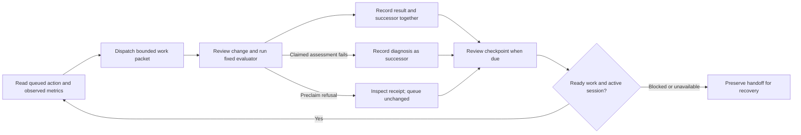

The loop should finish one useful step, evaluate what changed, and start the next eligible step while the supervisor is active. Its purpose is to improve evidence handling and representations across different entities. A larger graph, more generated text, or a passing synthetic example is not itself progress toward better predictions.

This document defines the working protocol. The [metric contracts](../experiments/representation-metrics.md) define its measurements, and the [component plan](meta-representation-build.md) defines the work packets. The runtime instructions are in the repository's `DAILY_LOOP.md`.

## What runs now

`engine/epiphysics/improvement.py` implements a dedicated local ledger, assessment, next-action selection, and a subprocess dispatcher. The present stage is `offline_fixture`: seven entity families and thirty representation checks, fourteen assertion-API checks, twenty-two manifest-API checks and twenty-six fixed graph-operation checks on fresh synthetic ledgers. There are no model calls, external spend, or automatic changes of scale. Assertions bind claims to source bytes; B1 manifests bind metadata and supplied forecasts. B2a executes only fixed graph identity/projection, generating output and removal losses. These checks establish neither semantic truth nor predictive advantage, and B2b split/merge remains separate.

The `reference` candidate copies expected answers and is an oracle control. The deliberately `degraded` candidate tests whether the evaluator detects losses. Neither is a learned representation. The controller hashes and captures its policy, suite, candidate, evaluator, assertion/manifest/transform implementations, capability probes, store and controller inputs; repeated identical run keys return the earlier result, while changed inputs with the same key are refused. Capability probes call the real APIs independently of those copied candidate answers.

The supervisor dispatches ready, authorized work immediately throughout its active session. Every **30 minutes or three core steps** is a checkpoint: record outcomes and resources, review priorities, and continue. It is not a reason to end active work. A 15-minute heartbeat is a recovery backstop; it checks for an active job and joins or inspects it instead of duplicating it. These are supervisor instructions, not a daemon in the Python module. A queued record does not keep an agent alive when the host or session is unavailable, and a missed wake resumes from recorded state without invented observations.

## Responsibilities and handoffs

| Role | Work and output | Boundary |
| --- | --- | --- |
| Primary supervisor | Reads status and metrics, selects the work packet, delegates file ownership, monitors workers, reviews evidence, and dispatches the successor | Owns the process; may not award itself new permissions, spending, or a passing final evaluation. |
| Builder subagents | Implement a scoped packet in assigned files; return changes, checks, limitations, and unfinished work | Cannot mark their own scientific claim independently validated. Parallel support work has separate ownership and explicit resource limits. |
| Allowlisted program workers | Execute a fixed local assessment and return process receipts and evaluator output | The current allowlist is only `epiphysics.improvement assess`; no arbitrary shell task, paid model runner, deployment, or settlement. |
| Independent reviewer/evaluator | Reviews contracts, failures and changes before acceptance; owns prospective final evaluation when that is implemented | Separate review is adopted now. Enforced optimizer/final-cohort isolation and fresh-cohort machinery remain planned. |



The ledger's atomic transition is specifically **assessment completion plus successor**, not an atomic transaction over an agent's edits, tests, and Git operations. `completed_work` describes the work actually done; it is not proof that a build packet passed acceptance. The supervisor must obtain the referenced checks and review before closing that packet.

The controller rejects a stale predecessor and concurrent claims for the same queued step. Failures caught after an assessment claim queue diagnosis; invalid JSON or policy can instead be refused before the claim, leaving the queue unchanged. A dispatched child's refusal is recorded in process receipts/output, not necessarily a ledger event. An interrupted claim requires inspection rather than blind replay. The dispatcher can close only its own reaped child's unfinished claim after failure; it preserves completed transitions and other workers' claims.

## Program execution and records

Use a persistent improvement store separate from the observatory store and outside disposable worktrees. Read status first:

```bash
PYTHONPATH=engine python3 -m epiphysics.improvement \
  --store /absolute/path/to/persistent-improvement-store status
```

For an initial smoke assessment, the fixed dispatcher can run:

```bash
PYTHONPATH=engine python3 -m epiphysics.improvement \
  --store /absolute/path/to/persistent-improvement-store dispatch \
  --policy engine/examples/improvement/policy.json \
  --suite engine/examples/improvement/entities.json \
  --candidate reference --run-key initial-contract-check \
  --after-step initial \
  --completed-work "Checked the synthetic oracle; no build packet completed" \
  --timeout-seconds 60
```

Later runs use the current `next_step.id`, a new run key for changed inputs, and the actual candidate output. Do not keep running the oracle to create activity. `dispatch` starts a real Python child with fixed arguments, `shell=False`, a minimal environment, the engine working directory, a maximum 60-second timeout, and a 1 MB combined output limit. The example policy additionally rejects assessments exceeding 30 seconds. Direct `assess` checks elapsed time after evaluation; use `dispatch` for the process timeout.

Receipts under `dispatches/<dispatch_id>/` include start/end times, process identity, arguments, return code, termination reason, output length/hash, and recovery status. Timeout enforcement requires the dispatcher to remain alive; after a crash, a start receipt without a finish receipt requires process investigation. These are trusted local process controls, not an operating-system security sandbox for untrusted code. Keep receipts and captured inputs private: paths, task descriptions, and output can contain local information. Publish reviewed aggregate results, never the private store by default.

Output delivery can fail after the assessment has durably completed, for example at the output cap. `assessment_completed_delivery_failed` then accompanies `delivery_status: failed`, `authoritative_transition_id`, and a bounded `authoritative_transition` containing the preserved result and successor. The CLI exits nonzero. Read that transition and current status, then dispatch the queued successor; do not rerun completed work. If no transition is confirmed, inspect receipts and ledger state. Invalid dispatcher arguments or store checks can fail before any child or receipt exists; not every error consumes a step.

## Predict the next useful action honestly

The selector records all candidate actions, their observed metric, target, direction, eligibility, and reason. It chooses in this order: temporal integrity, evidence mapping, missing answers, the weakest entity family, assertion failures, manifest failures, fixed-transform failures, then unimplemented split/merge preservation. `estimated_success_probability` and `estimated_cost` are currently `null`. This is an explicit heuristic with a directional hypothesis, not a calibrated prediction of return on effort.

On the next assessment, `prior_action_outcome` records the metric's new value, baseline, change, and whether the target was reached **only when all ten measurement-contract hashes match**: suite, evaluator, policy, assertion implementation, source-span probe, store, manifest implementation, manifest probe, transform implementation and transformation probe. Changed contracts produce `incomparable_contract_change` and list changed inputs, without a delta or `target_met`; a transition from a run lacking newly required module hashes is therefore incomparable. Candidate or controller changes alone do not prevent comparison. A missing prior measurement or metric is `unmeasured`. Comparable before/after changes remain descriptive; the controller cannot infer that the queued action caused them. Record failed attempts and actual resources as well as successes.

| Queued action | Work packet dispatched by supervisor | Acceptance before moving on |
| --- | --- | --- |
| `diagnose_failed_assessment` | Reproduce the specific failure; inspect owned receipts and ledger integrity | Explain failure and recovery; preserve original records; pass the relevant regression check. |
| `repair_time_eligibility` | Repair cutoff handling and late-evidence fixtures | Zero temporal violations on all required fixtures; no family regresses. |
| `repair_evidence_mapping` | Restore exact evidence ancestry in candidate output or adapter | Provenance reaches 1 on the declared suite; value errors remain visible. |
| `cover_missing_answers` | Implement missing query obligations or explicitly document unresolved cases | Coverage reaches 1 for fixture acceptance without replacing missing answers with unsupported guesses; accuracy and provenance also pass. |
| `repair_weakest_entity_family` | Fix the weakest family's failed dimensions | All seven families pass their declared contracts; retain per-case failures and tests. |
| `repair_source_span_assertions` | Repair the failing source-span or assertion-history API contract | All eight source-span and six history probes pass; inspect diagnostics and independently review the fix. |
| `repair_representation_manifests` | Repair B1 identity, artifact/evidence, cost-claim or forecast-binding failures | All twenty-two actual manifest API checks pass, with preceding gates retained and independent review. |
| `repair_graph_transformations` | Repair B2a identity/projection execution, mappings, computed losses or run-record failures | All twenty-six fixed-operation API checks pass with all preceding gates retained and independent review. |
| `build_split_merge_transformations` | Packet B2b: explicit split/merge mappings, collision and loss obligations | Implement and review a separate split/merge metric; projection success does not satisfy it. |

Packet A uses `source-span-probes-v1` (8 span and 6 history checks); B1 uses `representation-manifest-probes-v2` (22 checks). B2a adds `graph-transformation-probes-v2` (26 checks), which actually executes fixed graph identity/projection and records generated output/losses. Only all representation gates and capability fractions at 1 permit the B2b recommendation. No metric establishes semantic truth, arbitrary artifact execution or independently verified costs. `split_merge_preservation` remains unmeasured. Close B2b only with its own executable implementation, reviewed fixtures and metric; a queue entry never completes a capability or all of Packet B.

Longer term, a learned selector could forecast the chance and cost of an action improving a registered metric, compare itself with this fixed rule, and learn from all attempted actions. That requires stable action records, explicit uncertainty, outcome delays, protected evaluation, and fresh cohorts. It is planned research, not a feature of the present controller.

## Increase capability one axis at a time

The adopted controls are local input validation, fixed program dispatch, immutable records, explicit failure handling, zero external spend, disabled scale changes, independent code review, and regular supervisor checkpoints. Per-worker time/output limits remain hard limits; checkpoints do not terminate otherwise authorized active work. The stages below are **planned gates**, not granted execution authority.

| Stage | Candidate next increase | Gate fixed before trying it |
| --- | --- | --- |
| Offline fixtures — current | More realistic assertions and transformation cases | All required family contracts; zero time/provenance violations; resource ceiling and replay tests. |
| Shadow evaluation | Read permitted real inputs while decisions remain unchanged | Frozen comparator and cohort; family-specific practical margins and uncertainty; no side effects; reproducible rollback to prior adapter. |
| Limited canary | A small authorized service/workload fraction | Exposure and duration cap, independent control, latency/error/rights limits, stop rule, exercised rollback. |
| Multiple services or agents | More concurrency, service scope, or decision reach | Repeat prior gates under representative load; measure cross-service effects and failures; preserve per-family floors. |
| Exchange pilot | Simulated delivery/commitment/settlement, then separately authorized adapters | Verified delivery, disputes, duplicate handling, access rights and rollback/compensation; explicit domain budgets. |

Change only one of corpus size, model capability, concurrency, traffic, action scope, or spend at a time. Before a trial, declare the metric card, minimum cases/window, practical improvement margin, tolerated family regressions, side-effect limits, owner, and rollback. A missing or breached gate blocks promotion. Passing quality checks never confers permission to spend or broaden access.

Limited exposure and comparison with a control follow the principle of [canary evaluation](https://sre.google/workbook/canarying-releases/). Reliability limits should redirect work toward repair when exceeded, following the purpose of an [error-budget policy](https://sre.google/workbook/error-budget-policy/); this project must set its own thresholds before a live trial. Governance, context, measurement, and response stay connected across the lifecycle, consistent with the [NIST AI RMF Core](https://airc.nist.gov/airmf-resources/airmf/5-sec-core/). These references guide design; they do not certify this implementation.

The supervisor's success is a reproducible chain of useful changes and honest failures. Knowledge growth, predictive quality, operational reliability, and distribution of benefits require separate evidence. No universal value score or guaranteed growth follows from a self-repeating loop.
