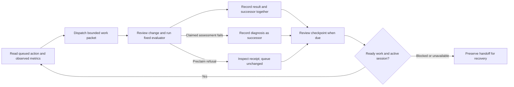

The loop should finish one useful step, evaluate what changed, and start the next eligible step while the supervisor is active. Its purpose is to improve evidence handling and representations across different entities. A larger graph, more generated text, or a passing synthetic example is not itself progress toward better predictions.

This document defines the working protocol. The [metric contracts](../experiments/representation-metrics.md) define its measurements, and the [component plan](meta-representation-build.md) defines the work packets. The runtime instructions are in the repository's `DAILY_LOOP.md`.

## What runs now

`engine/epiphysics/improvement.py` implements a dedicated local ledger, assessment, next-action selection, and a subprocess dispatcher. The present stage is `offline_fixture`: seven entity families and thirty representation checks, fourteen assertion checks, twenty-two manifest checks, twenty-six identity/projection checks forty-five graph partition/merge checks and thirty materialization checks on fresh synthetic ledgers. Program model calls, external spend and automatic scale changes remain disabled. B2a/B2b compute fixed graph outputs, losses and ancestry; they do not create physical entities or establish semantic truth or predictive advantage. B2c materializes complete output sets into usable representations/manifests with atomic receipts. C1 measured a four-source retrieval baseline; C2 validated its two retained runs and selected a representation comparison from the measured support gap. C3 separates indexing from measurement and compares fixed raw and HTML text projections before moving to fresh coverage evidence.

The `reference` candidate copies expected answers and is an oracle control. The deliberately `degraded` candidate tests whether the evaluator detects losses. Neither is a learned representation. The controller hashes and captures its policy, suite, candidate, evaluator, assertion/manifest/transform/graph-view/materialization implementations, capability probes, store and controller inputs; repeated identical run keys return the earlier result, while changed inputs with the same key are refused. Capability probes call the real APIs independently of those copied candidate answers.

The supervisor dispatches ready, authorized work immediately throughout its active session. Every **30 minutes or three core steps** is a checkpoint: record outcomes and resources, review priorities, and continue. It is not a reason to end active work. A 15-minute heartbeat is a recovery backstop; it checks for an active job and joins or inspects it instead of duplicating it. These are supervisor instructions, not a daemon in the Python module. A queued record does not keep an agent alive when the host or session is unavailable, and a missed wake resumes from recorded state without invented observations.

## Responsibilities and handoffs

| Role | Work and output | Boundary |
| --- | --- | --- |
| Primary supervisor | Reads status and metrics, selects the work packet, delegates file ownership, monitors workers, reviews evidence, and dispatches the successor | Owns the process; may not award itself new permissions, spending, or a passing final evaluation. |
| Builder subagents | Implement a scoped packet in assigned files; return changes, checks, limitations, and unfinished work | Cannot mark their own scientific claim independently validated. Parallel support work has separate ownership and explicit resource limits. |
| Allowlisted program workers | Execute a fixed local assessment and return process receipts and evaluator output | The current allowlist is only `epiphysics.improvement assess`; no arbitrary shell task, paid model runner, deployment, or settlement. |
| Independent reviewer/evaluator | Reviews contracts, failures and changes before acceptance; owns prospective final evaluation when that is implemented | Separate review is adopted now. Enforced optimizer/final-cohort isolation and fresh-cohort machinery remain planned. |



The ledger's atomic transition is specifically **assessment completion plus successor**, not an atomic transaction over an agent's edits, tests, and Git operations. `completed_work` describes the work actually done; it is not proof that a build packet passed acceptance. The supervisor must obtain the referenced checks and review before closing that packet.

The controller rejects a stale predecessor and concurrent claims for the same queued step. Failures caught after an assessment claim queue diagnosis; invalid JSON or policy can instead be refused before the claim, leaving the queue unchanged. A dispatched child's refusal is recorded in process receipts/output, not necessarily a ledger event. An interrupted claim requires inspection rather than blind replay. The dispatcher can close only its own reaped child's unfinished claim after failure; it preserves completed transitions and other workers' claims.

## Program execution and records

Use a persistent improvement store separate from the observatory store and outside disposable worktrees. Read status first:

```bash
PYTHONPATH=engine python3 -m epiphysics.improvement \
  --store /absolute/path/to/persistent-improvement-store status
```

For an initial smoke assessment, the fixed dispatcher can run:

```bash
PYTHONPATH=engine python3 -m epiphysics.improvement \
  --store /absolute/path/to/persistent-improvement-store dispatch \
  --policy engine/examples/improvement/policy.json \
  --suite engine/examples/improvement/entities.json \
  --candidate reference --run-key initial-contract-check \
  --after-step initial \
  --completed-work "Checked the synthetic oracle; no build packet completed" \
  --timeout-seconds 60
```

Later runs use the current `next_step.id`, a new run key for changed inputs, and the actual candidate output. Do not keep running the oracle to create activity. `dispatch` starts a real Python child with fixed arguments, `shell=False`, a minimal environment, the engine working directory, a maximum 60-second timeout, and a 1 MB combined output limit. The example policy additionally rejects assessments exceeding 30 seconds. Direct `assess` checks elapsed time after evaluation; use `dispatch` for the process timeout.

Receipts under `dispatches/<dispatch_id>/` include start/end times, process identity, arguments, return code, termination reason, output length/hash, and recovery status. Timeout enforcement requires the dispatcher to remain alive; after a crash, a start receipt without a finish receipt requires process investigation. These are trusted local process controls, not an operating-system security sandbox for untrusted code. Keep receipts and captured inputs private: paths, task descriptions, and output can contain local information. Publish reviewed aggregate results, never the private store by default.

Output delivery can fail after the assessment has durably completed, for example at the output cap. `assessment_completed_delivery_failed` then accompanies `delivery_status: failed`, `authoritative_transition_id`, and a bounded `authoritative_transition` containing the preserved result and successor. The CLI exits nonzero. Read that transition and current status, then dispatch the queued successor; do not rerun completed work. If no transition is confirmed, inspect receipts and ledger state. Invalid dispatcher arguments or store checks can fail before any child or receipt exists; not every error consumes a step.

## Predict the next useful action honestly

The selector records all candidate actions, their observed metric, target, direction, eligibility, and reason. It chooses in this order: temporal integrity, evidence mapping, missing answers, the weakest entity family, assertion failures, manifest failures, fixed-transform failures, graph-view failures, materialization failures, then missing or unreproduced actual retrieval. A validated reproduced baseline selects its observed support-ranking or coverage gap. `estimated_success_probability` and `estimated_cost` are currently `null`. This is an explicit heuristic with a directional hypothesis, not a calibrated prediction of return on effort.

For synthetic conformance metrics, the next assessment records in `prior_action_outcome` the metric's new value, baseline, change, and whether the target was reached **only when all fourteen measurement-contract hashes match**: suite, evaluator, policy, store, and the assertion, manifest, transform, graph-view and materialization implementations and their probes. Changed contracts produce `incomparable_contract_change` and list changed inputs, without a delta or `target_met`; a transition from a run lacking newly required module hashes is therefore incomparable. Candidate or controller changes alone do not prevent comparison. A missing prior measurement or metric is `unmeasured`. Comparable before/after changes remain descriptive; the controller cannot infer that the queued action caused them. Record failed attempts and actual resources as well as successes.

| Queued action | Work packet dispatched by supervisor | Acceptance before moving on |
| --- | --- | --- |
| `diagnose_failed_assessment` | Reproduce the specific failure; inspect owned receipts and ledger integrity | Explain failure and recovery; preserve original records; pass the relevant regression check. |
| `repair_time_eligibility` | Repair cutoff handling and late-evidence fixtures | Zero temporal violations on all required fixtures; no family regresses. |
| `repair_evidence_mapping` | Restore exact evidence ancestry in candidate output or adapter | Provenance reaches 1 on the declared suite; value errors remain visible. |
| `cover_missing_answers` | Implement missing query obligations or explicitly document unresolved cases | Coverage reaches 1 for fixture acceptance without replacing missing answers with unsupported guesses; accuracy and provenance also pass. |
| `repair_weakest_entity_family` | Fix the weakest family's failed dimensions | All seven families pass their declared contracts; retain per-case failures and tests. |
| `repair_source_span_assertions` | Repair the failing source-span or assertion-history API contract | All eight source-span and six history probes pass; inspect diagnostics and independently review the fix. |
| `repair_representation_manifests` | Repair B1 identity, artifact/evidence, cost-claim or forecast-binding failures | All twenty-two actual manifest API checks pass, with preceding gates retained and independent review. |
| `repair_graph_transformations` | Repair B2a identity/projection execution, mappings, computed losses or run-record failures | All twenty-six fixed-operation API checks pass with all preceding gates retained and independent review. |
| `repair_graph_views` | Repair B2b graph partition/merge, strict conflicts, ancestry, losses or run records | All forty-five actual graph-view checks pass with earlier gates retained and independent review. |
| `repair_transform_materialization` | Repair B2c output/manifests, ancestry, atomicity, replay or timing failures | All thirty actual materialization checks pass with earlier gates retained and independent review. |
| `build_retrieval_baseline` | Packet C: freeze eligible source bytes and questions; run an actual lexical baseline | Reproducible ranking and evidence spans, explicit missing answers, no future evidence, and a separately declared development evaluation. |
| `repair_retrieval_reproducibility` | Diagnose two valid but differing executions | Explain disagreement; retain both reports; use fresh reviewed executions and an unchanged declared measurement contract. |
| `prepare_retrieval_representation_comparison` | Separate candidate indexing from measurement; fix one source-preserving comparator | Explicit recipe, byte mappings, frozen sources/questions/gold/scoring, reference reproduction and declared costs before comparison. |
| `prepare_retrieval_coverage_evaluation` | Prepare fresh paired queries and complete-support scoring | Retain reviewed cohort, protocol and freeze before new retrieval; development labels remain visible to builders. |
| `execute_fresh_coverage_baseline` | C4: run the frozen raw candidate twice | Validated preparation supplies two exclusive run keys; no invented outputs or quality in readiness. |
| `inspect_fresh_support_failures` | C5: inspect reproduced incomplete support | Check retained bundle/window intervals and attributed semantic review against the actual originating transition; preserve original bytes and scores. |
| `prepare_focused_support_followup` | C6: prepare and execute one fixed two-clause diagnostic | Freeze the protocol, review and envelope before two declared runs; verify exact requests, source bytes, caller evidence and changed selection budget in one composite acceptance. |
| `prepare_control_exchange_decision_pilot` | Prepare an offline authorization/delivery/settlement comparison | Define the simulator, candidate views, evaluator boundaries, costs and per-scenario denominators; this queue entry executes no payment or control decision. |
| `clarify_support_diagnosis` | Examine deferred cases, annotation gaps or unresolved judgments | Retain uncertainty and original labels; any annotation amendment requires a new reviewed version. |
| `repair_decision_pilot` | Repair the specific execution, provenance or fixed-policy conformance failure | Retain every attempted case, preserve the independent evaluator, verify the repair on owned controls before interpreting results. |
| `prepare_fresh_decision_comparison` | Freeze one 24-case exploratory protocol after the exposed decision-development result | Independent custody and review, explicit negative-artifact and dispute/timing coverage, paired inputs, fixed denominators and budgets; no live effects or authority increase. |
| `prepare_prospective_decision_shadow` | Prepare one dated, nonacting question after the fresh exploratory triage margin is met | Require at least two additional valid releases, no increase in each proposal-harm count, no additional failures and passing conformance; a research choice, not adoption or expanded authority. |
| `investigate_decision_information_limits` | Explain paired losses and missing information when the fresh margin is not met | Preserve the simpler baseline and all exposed cases; specify the next informative question without retuning or rerunning the same comparison. |
| `repair_decision_information_diagnosis` | Repair a failed retained-input/output conformance check | Preserve accepted C8 ancestry; a corrected full diagnosis must pass before normal continuation. |
| `review_unresolved_decision_evidence` | Inspect specific unresolved evidence identities and reasons | An unchanged, checked gap set can carry forward as missing-data requirements; it remains unresolved. |
| `prepare_dated_evidence_quality_protocol` | Define one future, nonacting delivery with checkable quality evidence | Freeze criteria, artifact/source digests, actor roles, verifier method, time semantics and outcome rules; no retroactive holdout or generic assessment substitution. |
| `repair_dated_evidence_quality_protocol` | Correct a measured preparation failure | Preserve the original attempt; bind the corrected validation evidence to its actual queued parent. |
| `bind_dated_artifact_delivery` | Register one eligible maintenance delivery | Accepted preparation and exact protocol bytes precede the first submission; no eligible task leaves the step pending. |
| `check_dated_artifact_delivery` | Evaluate the first captured inventory | A separate evidence checkpoint includes new observations. Pending evidence refuses before claim; deadline-backed missingness is a result, not an invented score. |
| `review_dated_delivery_evidence` | Close one unresolved check | Retain original missingness and deadlines, add a new independent closure, then advance without another identical review. |
| `prepare_public_research_map_view` | Make retained claims, sources and results navigable | Build from the curated map and public records; moving decorative points are not measured research relationships. |
| `prepare_answerability_evidence_gaps` | C4: define evidence needed beyond complete support | Account for unsupported matches and unmeasured families; no classifier or new source acquisition inferred from lexical matches alone. |

The actual [C9 diagnosis](../experiments/results/2026-11-26-decision-information-limits.md) completed with 96 reconciled attempts and selected dated evidence-quality preparation. Its zero unresolved rows measure engineering reconciliation, not causal certainty. Completion and the successor share one ledger event. Continue work from that accepted event; exact replay returns the recorded result without computing another diagnosis.

The [C4 execution record](runs/2026-11-26-retrieval-coverage.md) establishes the actual preparation → two raw runs → support-diagnosis transition. The complete-support alternative is verified on owned fixtures; it was not selected by this real cohort. Readiness has no quality values, and preparation/evaluation retain the same frozen measurement identity.

The schema-3 `support_diagnosis` phase reuses the same captured-evidence and fixed-dispatch path. It binds one original completion event to the live queued predecessor, reconciles required spans with actual returned windows, and records semantic review as attributed judgment. It produces `report.support_diagnosis`, not a new `actual_retrieval` result. All failed cases remain visible even when review focuses on a subset. Earlier integrity/conformance repairs retain priority; otherwise complete review of retrieval gaps selects follow-up preparation, while deferred cases or uncertain/annotation judgments select clarification. The previous quality outcome stays `unmeasured`. See the [diagnosis protocol](../experiments/retrieval-support-diagnosis.md).

The subsequent `support_probe` phase accepts the fixed preparation and actual executions together. It binds its inherited prefix to the accepted diagnosis and its envelope to an observation before the two starts. Every receipt must match its own declared request; matching wrong repeats do not pass. An incomplete execution fails with retained evidence. Valid repeated disagreement selects repair; every reproduced support outcome selects only decision-pilot preparation. `report.support_probe` has no replacement C4 quality score or adoption decision. See the [fixed-clause protocol](../experiments/retrieval-fixed-clause-probe.md).

The separate `--decision-study` path consumes retained results from one exposed twelve-case release-or-hold comparison. It verifies the exact four-arm inventory, source views, raw receipts and independent world/observer metrics without executing candidate code again. Its origin identifies the current queued decision-pilot step; this is a local queue binding, not the inherited external-evidence transport of retrieval studies. Successful conformance selects preparation of one fresh exploratory comparison regardless of which compact view did better. Failed conformance selects repair. The supervisor must carry out that preparation; recording its name does not execute it. The [development result](../experiments/results/2026-11-26-decision-pilot.md) keeps hidden-rights errors separate from retention losses and simulated effects.

Its `fresh_comparison` extension binds the exact accepted development event and historical implementation identities to one separately generated 24-case exploratory batch. New source identities are recorded separately. Registration, immutable generation custody, caller first-read claim, execution receipts and the 194-record journal are checked before the controller can consume the queued step. Every one of the 96 attempt outputs is retained, including failures. A separate outer process owner bounds the entire caller, driver and worker group through final caller persistence. The supervisor selects a successor from the checked result, then carries out its preparation; none of these queue entries can be consumed by a generic synthetic assessment with their evidence omitted. See the [fixed protocol](../experiments/control-exchange-fresh-comparison.md).

Packet A uses `source-span-probes-v1` (8 span and 6 history checks); B1 uses `representation-manifest-probes-v2` (22); B2a uses `graph-transformation-probes-v2` (26); B2b uses `graph-view-probes-v1` (45); B2c uses `materialization-probes-v1` (30). B2a/B2b execute fixed operations and retain generated graphs and losses; B2c creates checked consumer records. All representation gates and capability fractions must equal 1 before the Packet C recommendation. No metric establishes semantic truth, arbitrary artifact execution or independently verified costs. `retrieval_baseline_reproducibility` remains unmeasured without validated actual execution evidence; the C2 study adapter supplies that separate measurement. A queue entry does not implement that next capability.

The retrieval successor has two concrete substeps. C1 builds and measures the standalone lexical baseline on the frozen development corpus; C2 validates those real receipts and imports their identified metrics through `--retrieval-study FILE`. Without the validated study input, the dedicated queue action remains open. Use the [exact study examples](../../engine/examples/retrieval/README.md); they bind the original corpus and two distinct executions without embedding third-party source bytes.

C2 retains the captured inputs and both recomputed evaluation reports. It keeps the actual retrieval metric separate from synthetic conformance. Invalid supplied evidence queues diagnosis; two valid differing results queue `repair_retrieval_reproducibility`. Reproduced support gaps queue `prepare_retrieval_representation_comparison`; otherwise `prepare_retrieval_coverage_evaluation` calls for a bounded unseen-query/answerability protocol. The supervisor dispatches that scoped work immediately after review and assessment. A queue entry still does not execute its own build.

Retrieval outcomes compare their explicit measurement identities separately from the synthetic contract list above. Fresh execution IDs are not a changed measurement method. Source, cohort, gold, scoring or currently coupled candidate/validation changes prevent a comparable delta. A missing prior measurement stays unmeasured; no declared quality threshold means `target_met: null`. A fixed hypothesis can prioritize a development gap without inventing a probability, causal effect or universal utility score.

Longer term, a learned selector could forecast the chance and cost of an action improving a registered metric, compare itself with this fixed rule, and learn from all attempted actions. That requires stable action records, explicit uncertainty, outcome delays, protected evaluation, and fresh cohorts. It is planned research, not a feature of the present controller.

Current resource receipts measure the assessment program, not the full builder/reviewer effort. Zero program model calls or external spend does not establish a cost-free improvement. Record whole-step costs separately before treating outcomes as training data for return-on-effort predictions.

## Increase capability one axis at a time

The adopted controls are local input validation, fixed program dispatch, immutable records, explicit failure handling, zero external spend, disabled scale changes, independent code review, and regular supervisor checkpoints. Per-worker time/output limits remain hard limits; checkpoints do not terminate otherwise authorized active work. The stages below are **planned gates**, not granted execution authority.

| Stage | Candidate next increase | Gate fixed before trying it |
| --- | --- | --- |
| Offline fixtures — current | More realistic assertions and transformation cases | All required family contracts; zero time/provenance violations; resource ceiling and replay tests. |
| Shadow evaluation | Read permitted real inputs while decisions remain unchanged | Frozen comparator and cohort; family-specific practical margins and uncertainty; no side effects; reproducible rollback to prior adapter. |
| Limited canary | A small authorized service/workload fraction | Exposure and duration cap, independent control, latency/error/rights limits, stop rule, exercised rollback. |
| Multiple services or agents | More concurrency, service scope, or decision reach | Repeat prior gates under representative load; measure cross-service effects and failures; preserve per-family floors. |
| Exchange pilot | Simulated delivery/commitment/settlement, then separately authorized adapters | Verified delivery, disputes, duplicate handling, access rights and rollback/compensation; explicit domain budgets. |

Change only one of corpus size, model capability, concurrency, traffic, action scope, or spend at a time. Before a trial, declare the metric card, minimum cases/window, practical improvement margin, tolerated family regressions, side-effect limits, owner, and rollback. A missing or breached gate blocks promotion. Passing quality checks never confers permission to spend or broaden access.

Limited exposure and comparison with a control follow the principle of [canary evaluation](https://sre.google/workbook/canarying-releases/). Reliability limits should redirect work toward repair when exceeded, following the purpose of an [error-budget policy](https://sre.google/workbook/error-budget-policy/); this project must set its own thresholds before a live trial. Governance, context, measurement, and response stay connected across the lifecycle, consistent with the [NIST AI RMF Core](https://airc.nist.gov/airmf-resources/airmf/5-sec-core/). These references guide design; they do not certify this implementation.

The supervisor's success is a reproducible chain of useful changes and honest failures. Knowledge growth, predictive quality, operational reliability, and distribution of benefits require separate evidence. No universal value score or guaranteed growth follows from a self-repeating loop.
